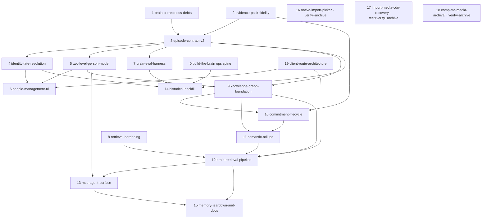

# Brain Roadmap — Change Sequencing & Dependency Chart

> Written 2026-07-11, after the multi-agent architecture review (26 adversarially-verified findings). Governing strategy: **finalize the write contract → make quality measurable → then spend.** All brain data is derived and rebuildable, so wipe-and-regenerate replaces migration machinery everywhere; the only expensive do-over is re-running extraction over the archive, which is why `episode-contract-v2` gates the backfill.
>
> Each change listed below has a proposal-level seed at `openspec/changes/<name>/proposal.md`. Expand a change with `/opsx:propose` when its turn comes; proposals for later waves are deliberately lighter so earlier gates can inform them.
>
> **Ask `/next-change`** at any time for the current recommendation: which change to do next, which model to use, and the pre-flight checklist — derived live from this file and each change folder's actual state.

## Change Inventory

| # | Change | Model | Status | Hard dependencies | Checkpoint (gate) |
|---|--------|-------|--------|-------------------|-------------------|
| 0 | `build-the-brain` (narrowed) | Opus | **archived 2026-07-12** | — (ops-spine remainder paired naturally with #3) | gates 2.7 / 3.8 passed live (scheduler, catch-up, crash-resume, staleness); archived to `archive/2026-07-12-build-the-brain` |
| 1 | `brain-correctness-debts` | Opus | **archived 2026-07-12** | — | compound-cursor watermark, merge rekey, run honesty, startup probe, real usage — shipped; gates 11.1/11.3 test-covered, 11.2 verified live; archived to `archive/2026-07-12-brain-correctness-debts` |
| 2 | `evidence-pack-fidelity` | Opus | seeded | — (#1 recommended first) | reactions/replies/forwards/number-labels visible in a real episode; week-bounded quiet-chat packs |
| 3 | `episode-contract-v2` | **Fable** | seeded | #1, #2 | wipe + assimilate 2–3 chats: entities, absolute dates, hedges in claims; salvageable weak-model JSON |
| 4 | `identity-late-resolution` | Opus | seeded | #3 | save a contact → old episodes + search repair with zero model calls |
| 5 | `two-level-person-model` | **Fable** | seeded | #3 | same-name stays separate; Google same-contact auto-connects; disconnect re-derives, zero episode changes |
| 6 | `people-management-ui` | Sonnet | seeded | #4, #5, #19 | ranked hygiene queue; dismissed pair stays dismissed |
| 7 | `brain-eval-harness` | Opus | seeded | #3 | recall table + per-model precision/fallback tables on the real archive |
| 8 | `retrieval-hardening` | Opus | seeded | — (#7 soft, to measure delta; rename hook shared with #4) | typo'd query returns labelled relaxed results; "nhi" finds "nahi"; renamed contact searchable |
| 9 | `knowledge-graph-foundation` | Opus | seeded | #3, #5 | nodes/edges from claim entities; open commitment survives salience recompute |
| 10 | `commitment-lifecycle` | **Fable** | seeded | #2, #3, #9 | promise → reaction-acknowledged → cited closure; overdue flagged |
| 11 | `semantic-rollups` | **Fable** | seeded | #9, #10 (adjacent) | coherent cited entity pages; undeclared claim-drop refused; mechanical rollback |
| 12 | `brain-retrieval-pipeline` | **Fable** | seeded | #8, #9, #11, #19 (query-panel UI) | zero-keyword paraphrase recovered in deep mode; coverage verdict + gap sentences; one-call week summary |
| 13 | `mcp-agent-surface` | Opus | seeded | #5, #12 | Haiku-class client answers cited in ≤2 calls via `brain_ask`; attributed agent spend |
| 14 | `historical-backfill` | Opus | seeded | #0 (spine), #3, #4, #7 | kill-resume clean; coverage climbing; named budget stops |
| 15 | `memory-teardown-and-docs` | Sonnet | seeded | #12, #13 | no `memory_*` remnants; docs match reality; full suite green |
| 16 | `native-import-picker` | Sonnet | **archived 2026-07-11** | — (independent of the brain chain) | gate 9.1 passed; archived to `archive/2026-07-11-native-import-picker` |
| 17 | `import-media-cdn-recovery` | Sonnet | **archived 2026-07-12** | — (independent) | gates 6.1/6.2 passed on the real archive; archived to `archive/2026-07-12-import-media-cdn-recovery` |
| 18 | `complete-media-archival` | Sonnet | **archived 2026-07-12** | — (independent; richer media improves evidence interpretation labels, no blocker either way) | gates 11.1/11.3–11.5 passed live with a real sender; archived to `archive/2026-07-12-complete-media-archival` |
| 19 | `client-route-architecture` | Opus | seeded | — (pure client refactor; soft: before #7's grading strip, #13's grants UI, #14's dashboard) | every surface at its own URL, reload-safe; search deep links navigate routes; App.tsx reduced to a shell |

**Model column** — the Claude model recommended to drive each change's `/opsx:propose` + implementation session. **Fable** where irreversible design judgment concentrates: #3 (the extraction contract is the system's embedding function — every episode ever written inherits it), #5 (person/identity semantics must be right forever), #10/#11 (lifecycle + anti-rot rollup machinery, the highest-rot vector, designed as a pair), #12 (ranking/fusion/coverage-verdict design — the product surface). **Opus** for everything demanding but well-specified by its proposal (core-transaction surgery, pack building, graph mechanics, refactors). **Sonnet** only where the path is fully paved: CRUD UI over decided tables (#6), deletion + docs (#15), and the three verify-and-archive closeouts (#16–18).

**Definition of done for this roadmap**: every folder under `openspec/changes/` is archived. Each change is `/opsx:archive`d after its checkpoint passes; #16–18 need only their verification gates (plus one test for #17) and can close in Wave A. This file itself is absorbed into the docs pass and retired at #15.

## Dependency Graph

## Execution Waves

Changes within a wave can run in any order or in parallel; a wave starts when its members' dependencies are met.

- **Wave A — now, parallel**: `brain-correctness-debts` (1), `evidence-pack-fidelity` (2). `retrieval-hardening` (8) and `client-route-architecture` (19) are dependency-free and can slot in from here on — 19 is pure client work, fully parallel to the server-side chain, and must land before Wave D's `people-management-ui` (its own hard deadline; earlier is better so #7's grading strip and #14's dashboard are born on the `/brain` page rather than added to the monolith). Also in this wave: **close out the three near-done archive-layer changes** — `native-import-picker` (16: run gate 9.1), `import-media-cdn-recovery` (17: write parser test 5.1, run gates 6.1/6.2), `complete-media-archival` (18: run gates 11.1/11.3–11.5) — then `/opsx:archive` each.
- **Wave B — the keystone**: `episode-contract-v2` (3). Everything downstream consumes its contract; nothing token-expensive should run before it lands. The `build-the-brain` ops-spine remainder (run objects 3.5, scheduler 3.3, catch-up audit) pairs naturally with this wave.
- **Wave C — parallel after the contract**: `identity-late-resolution` (4), `two-level-person-model` (5), `brain-eval-harness` (7).
- **Wave D — parallel**: `people-management-ui` (6), `knowledge-graph-foundation` (9). **`historical-backfill` (14) may START here** (gates 3/4/7 met) and runs as a months-long background drain or attended turbo sessions while later waves are built — coverage metadata keeps partial assimilation honest by design.
- **Wave E — adjacent pair**: `commitment-lifecycle` (10) then `semantic-rollups` (11) — closure executes inside rollup calls, so specify together, land back-to-back.
- **Wave F**: `brain-retrieval-pipeline` (12).
- **Wave G**: `mcp-agent-surface` (13).
- **Wave H — closeout**: `memory-teardown-and-docs` (15).

## `build-the-brain` Supersession Map

| Original task | Disposition |
|---|---|
| Phases 1–2 (1.1–2.8) | Delivered; untouched |
| 2.7 gate, 3.3 scheduler, 3.5 run objects, 3.7 tests, 3.8 gate | **Stay in `build-the-brain`** (operational spine) |
| 3.4 catch-up audit | Stays; its `--turbo` backfill half → `historical-backfill` |
| 3.2 full extraction | → `episode-contract-v2` (extended: event-time, confidence, versioning, validation v2, injection hardening, late-binding stamps) |
| 3.6 staleness | Edits/deletes/interpretation staleness stays; merge rekey → `brain-correctness-debts`; name repair → `identity-late-resolution`; person auto-merge → `two-level-person-model` |
| 4.1/4.2/4.4 rollups + guard + projection | → `semantic-rollups` (declared supersession, input quotas, extractive quarantine) |
| 4.3 graph + salience | → `knowledge-graph-foundation` (+ kind-aware dormancy) + `two-level-person-model` (membership replaces person hard-merges) |
| 4.5 retrieval | → `brain-retrieval-pipeline` (layered merge, coverage verdicts, pinned deep path, timeline + claims) |
| 4.6 memory removal | → `memory-teardown-and-docs` |
| 5.x MCP | → `mcp-agent-surface` (+ `brain_ask`, spend authority, weak-model gate) |
| 6.x docs/closeout | → `memory-teardown-and-docs` |
| *(new, no predecessor)* | `brain-eval-harness`, `evidence-pack-fidelity`, `identity-late-resolution`, `people-management-ui`, `retrieval-hardening`, `commitment-lifecycle` |

## Clean Slate & Breaking-Change Sanction

- **Clean slate executed 2026-07-11**: all partial brain derived data was wiped before roadmap start — 30 episodes, their claims/citations, all watermarks, and 30 projected episode files removed via `POST /api/brain/reset`; `GET /api/brain/episodes` confirmed empty. The roadmap begins from zero assimilation. (The reset surfaced a coverage-count artifact — `assimilatedVisibleMessages: 1` with zero watermark rows, a timestamp-0 message counted by the `<=` predicate — additional evidence for `brain-correctness-debts`' watermark-predicate fixes.)
- **Standing sanction (user, 2026-07-11)**: at ANY point in this roadmap, breaking changes are allowed — schema drop-and-recreate instead of additive migration, contract changes without compatibility shims, and wiping some or all derived data (brain tables, FTS, graph, persons, eval runs) whenever a cleaner design results. The archive layer (`messages`, `chats`, `contacts`, media blobs) is the only data that must never be lost; everything above it is rebuildable by construction. Changes SHOULD prefer the clean redesign over the compatible-but-compromised one and note in their proposal when a wipe is part of the plan.

## Standing Principles (from the review)

1. **Contract before spend**: no archive-scale assimilation until `episode-contract-v2` + `brain-eval-harness` are green. Re-extraction is the only expensive do-over in the system.
2. **Store references, render names**: derived layers key on JIDs/node ids and resolve display names at read time; names baked into generated prose must be number-labelled (substitutable) and stamped for repair. No derived layer may treat a display name as immutable input.
3. **Late-binding inventory**: identity, media interpretation, quoted replies, reactions, forwards, chat names, topics — each needs an anchor, a version/coverage stamp, and a repair path. Any new feature baking an interpretation into stored text must say which row it adds to this table (kept in `build-the-brain/design.md`).
4. **Under-merge beats over-merge**: person identity is an editable membership, never a destructive merge; suggestions are produced by detectors and applied only by certainty-grade sources or the user.
5. **Deterministic first, model second**: repair, closure candidates, conflict candidates, input selection, and `brain_ask` are all pure-SQL scaffolding; model calls are reserved for synthesis the structure cannot do.
6. **Weak model reads, mid model writes, strong model consolidates**: the read surface must satisfy a Haiku-class client (`brain_ask` gate); episode writes stay mid-tier with structural validation; flagship tiers are reserved for rollup-class synthesis.
